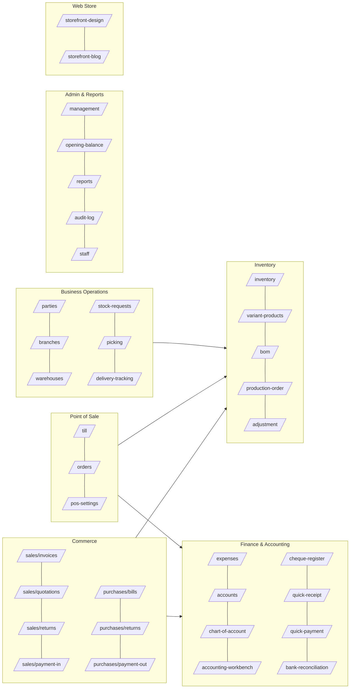

# 02 — Navigation and Route Map (Admin scope)

**Evidence:** REA `capture_browser_scenario` with all sidebar groups expanded + accessibility snapshot (`ev_8166f5d9…`), RSC prefetch capture (`evidence/captures/raw-02-commerce-lists.json`), bundle route literals (Phase 1).
Tags: `[OBS]` seen in the live Admin UI · `[BND]` seen only as a bundle literal (not yet in the UI) · `[INF]` inferred.
Tenant, user and party names are intentionally omitted.

## 1. Sidebar tree (exact labels → routes) `[OBS]`

```
Platform
└─ Dashboard ................................ /
Business Operations
├─ Parties .................................. /parties
├─ Branches & Warehouses (group)
│  ├─ Branches .............................. /branches
│  └─ Warehouses ............................ /warehouses
├─ Stock Request ............................ /stock-requests
├─ Picking .................................. /picking
├─ Delivery Tracking ........................ /delivery-tracking
├─ Inventory (group)
│  ├─ Products .............................. /inventory
│  ├─ Variant Products ...................... /inventory/variant-products
│  ├─ Variant Attributes .................... /inventory/variant-attributes
│  ├─ Product Category ...................... /inventory/product-category
│  ├─ Units Of Measurement .................. /inventory/units
│  ├─ Inventory Adjustment .................. /inventory/adjustment
│  ├─ OC / DC Documents ..................... /inventory/documents
│  ├─ Bills Of Materials .................... /inventory/bom
│  └─ Production Order ...................... /inventory/production-order
├─ Sales (group)
│  ├─ Sales Invoice / Create ................ /sales/invoices, /sales/invoices/create
│  ├─ Payment In ............................ /sales/payment-in
│  ├─ Quotations / Create ................... /sales/quotations, /sales/quotations/create
│  └─ Sales Return / Create ................. /sales/returns, /sales/returns/create
└─ Purchase (group)
   ├─ Purchase Bill / Create ................ /purchases/bills, /purchases/bills/create
   ├─ Payment Out ........................... /purchases/payment-out
   └─ Purchase Return / Create .............. /purchases/returns, /purchases/returns/create
Point of Sale
├─ Retail Till .............................. /till
└─ POS (group)
   ├─ Orders ................................ /orders
   └─ POS Settings .......................... /pos-settings
Web Store
└─ Web Store (group)
   ├─ Storefront Design ..................... /storefront-design
   └─ Journal ............................... /storefront-blog
Financial Management
├─ Expenses ................................. /expenses
└─ Accounting (group)
   ├─ Manage Accounts ....................... /accounts
   ├─ Chart of Account ...................... /accounts/chart-of-account
   ├─ Accounting Workbench .................. /accounting-workbench
   ├─ Cheque Register ....................... /cheque-register
   ├─ Quick Receipt ......................... /quick-receipt
   ├─ Quick Payment ......................... /quick-payment
   └─ Bank Reconciliation ................... /bank-reconciliation
Administration & Reports
├─ Management ............................... /management
├─ Opening Balance .......................... /opening-balance
├─ Reports .................................. /reports
├─ Audit Log ................................ /audit-log
└─ Manage Staffs ............................ /staff
Tools & Utilities
├─ Import Data .............................. /import-data
└─ Business Tools ........................... /business-tools
```

**Header (global):** Global search (searchbox) · Quick Add · Notifications (badge count) · user menu (user + tenant name) · Switch Profile · Toggle sidebar.

## 2. Routes reachable outside the sidebar

| Route | How reached | Tag |
|---|---|---|
| `/accounting?report=aging-receivables&asOf=` | dashboard links | OBS |
| `/accounting?report=aging-payables&asOf=` | dashboard | OBS |
| `/accounting?report=profit-loss&from=&to=` | dashboard | OBS |
| `/accounting?report=cash-flow&from=&to=` | dashboard | OBS |
| `/reports/sales-register?from=&to=` | dashboard KPI | OBS |
| `/reports/purchase-register?from=&to=` | dashboard KPI | OBS |
| `/reports/income-statement?from=&to=` | dashboard KPI | OBS |
| `/reports/inventory-position` | dashboard KPI | OBS |
| `/reports/sales-by-item`, `/reports/sales-by-customer` | dashboard cards | OBS |
| `/reports/invoice-age?statuses=overdue` | dashboard | OBS |
| `/inventory/{uuid}` (product detail) | dashboard watch list | OBS |
| `/inventory?stock=low_stock|out_of_stock` | dashboard | OBS |
| `/parties?party={uuid}` (party drawer/detail) | dashboard | OBS |
| `/stock-requests?view=moves` | dashboard "Shipments on the road" | OBS |
| `/pms` ("Service visits due") | dashboard only, **not in sidebar** | OBS |
| `/import-data/parties` | RSC prefetch | OBS |
| `/inventory/new`, `/inventory/warehouse-transfer`, `/inventory/expiry`, `/expenses/create`, `/stock-requests/new`, `/inventory/variant-products/new`, `/settings` | bundle literal | BND |
| `/reports/balance-sheet`, `customer-statement`, `supplier-statement`, `detail-general-ledger`, `gl-master`, `gl-summary`, `transaction-list` | bundle literal | BND |
| `/accounting` (bare) | bundle literal + `?report=` links | OBS |

## 3. Routing conventions `[OBS]`
- **Primary keys are UUIDs** (`/inventory/f41a…`, `/parties?party=3b96…`).
- **List filters live in query strings** (`?stock=`, `?view=`, `?statuses=`), so filtered views are linkable.
- **Reports take date ranges** as `from`/`to` (ISO dates) or `asOf` for point-in-time reports.
- **Accounting reports are one page with a `?report=` switch.** Operational reports are separate `/reports/*` routes.
- **Create is a separate route** (`/…/create`) rather than a modal for the main documents.
- The dashboard has a period tablist (7d / 30d / this month / 90d / 12m) and compares each period with the previous one.

## 4. Route → module mapping (Mermaid)


(Cross-module arrows are `[INF]` from shared endpoints; they are confirmed or refuted per workflow in Phase 2/7.)
