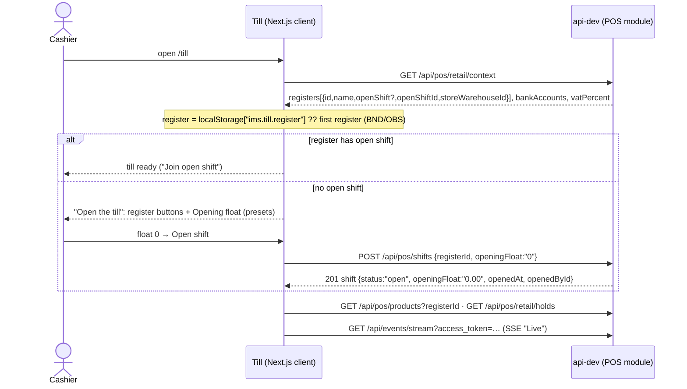
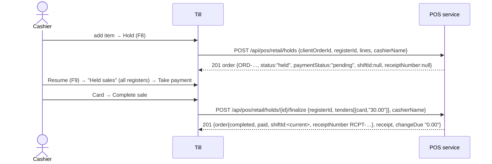
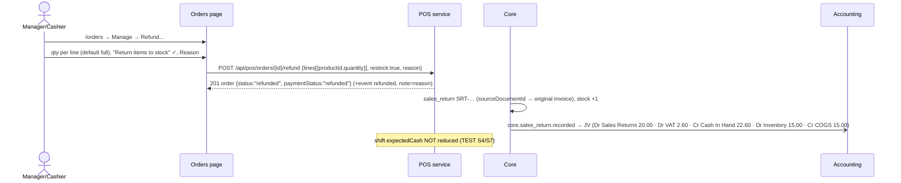
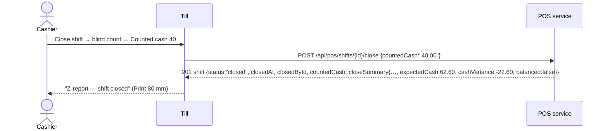
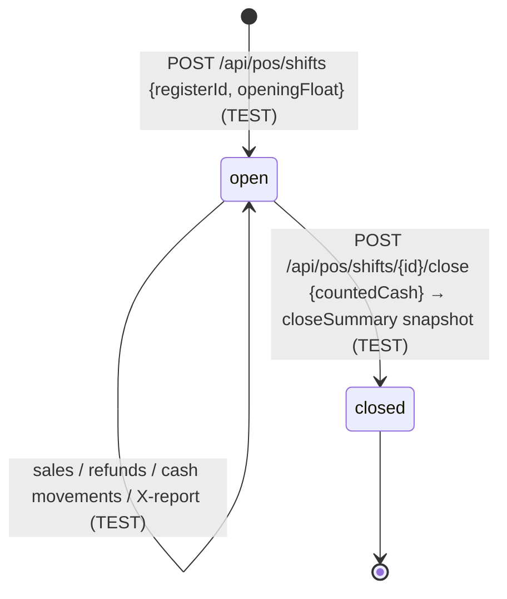
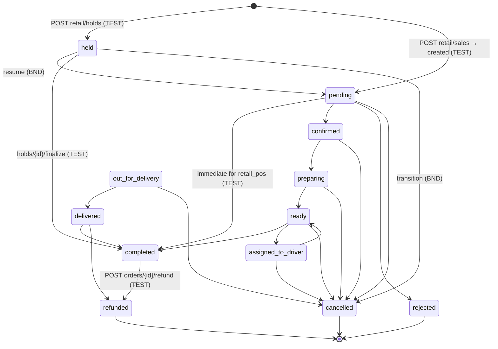

# 02 — MeroIMS POS Workflows, Sequences & Lifecycles

Every step below is tagged. **TEST** = observed in an approved write test (S1–S7); **OBS** = observed read-only; **BND** = client code only; **INF** = inference; **UNK** = unknown. Timings come from captured timestamps.

---

## 1. Open shift (S2)

Observed effects: no journal, no money-account change (float 0). Non-zero float effect **UNK**.

## 2. Retail sale (S3)
```mermaid
sequenceDiagram
  actor C as Cashier
  participant T as Till
  participant POS as POS service
  participant CORE as Core (documents, stock)
  participant BUS as Event pipeline (INF)
  participant ACC as Accounting
  C->>T: search SKU → click tile (cart, in-memory)
  C->>T: Tender → Cash received 50 → Complete sale
  T->>POS: POST /api/pos/retail/sales {clientOrderId(uuid), registerId, lines[{productId,quantity}], tenders[{cash,"50.00"}], cashierName}
  POS->>POS: price lines server-side (VAT-exclusive: 20.00 + 13% = 22.60)
  POS-->>T: 201 {order{ORD-…, completed, paid, tenders[{cash,22.60}]}, receipt{RCPT-…}, cashReceived 50.00, changeDue 27.40}
  Note over POS,CORE: same request window (INF): sales_invoice INV-… (settled, posOrderId, unitCost snapshot), stock −1
  CORE-)BUS: core.invoice.issued (sourceEventType on journal)
  BUS-)ACC: ~1.8 s later: JV-… posted (Dr Cash In Hand 22.60 · Cr Sales 20.00 · Cr VAT 2.60 · Dr COGS 15.00 · Cr Inventory 15.00)
  T-->>C: change due; receipt (80 mm print available)
```
Order events: `created (→pending)` and `completed (pending→completed)` in the same millisecond (TEST).
Whether invoice + stock are written in the same DB transaction as the order: **UNK**. Journal is clearly asynchronous (INF from 1.8 s gap).

## 3. Hold → resume → finalize with card (S5)

Downstream identical to §2 (invoice, stock −1, journal). **Card is debited to Cash In Hand** (TEST).

## 4. Refund (S4)

Original invoice and journal unchanged (append-only). Refund method = implicit original tender (INF).

## 5. Cash in / out (S6)
`POST /api/pos/retail/shifts/{id}/cash-movements {type: paid_in|paid_out|drop, amount, reason}` → 201 movement record. Shift figures update; **no journal, no money-account change** (TEST).

## 6. Close shift / Z-report (S7)

No journal for the variance (TEST).

---

## 7. Lifecycles (state machines)

### 7.1 Register

```mermaid
stateDiagram-v2
  [*] --> Active: POST /api/pos/admin/registers (TEST)
  Active --> Inactive: Turn off (OBS button, UNK request)
  Inactive --> Active: (UNK)
  Active --> [*]: Remove (OBS button; behaviour with past shifts UNK)
```


### 7.2 Shift

Constraints observed: one open shift per register (INF from `openShiftId`); several registers open concurrently (OBS).

### 7.3 POS order (`status`)
From the client transition map (BND) plus tested paths (TEST):

Kitchen/delivery statuses (confirmed…delivered) are not reachable for `retail_pos` in tests; they belong to restaurant/delivery channels (INF).

### 7.4 Payment status (`paymentStatus`)
`pending` (held) → `paid` (sale/finalize) → `refunded` (refund) — TEST. Bundle also has `unpaid`, `partially_paid` (BND, not observed).

### 7.5 Tender
Created only with the sale/finalize; stored as **applied amount** (`{type, amount, capturedAt}`), separate from `cashReceived`/`changeDue` (TEST). No tender rows are created by refunds (TEST).

### 7.6 Receipt
Number `RCPT-NNNNNN` assigned at completion (TEST); not assigned to held orders (TEST). Reprint via `/print/receipt/{id}` (OBS link). Refund receipt **UNK** (none observed).

### 7.7 Documents & journals created by POS
| POS event | Document | Journal `sourceEventType` |
|---|---|---|
| Sale / finalize | `sales_invoice` (settled at entry, `posOrderId`) | `core.invoice.issued` |
| Refund | `sales_return` (`sourceDocumentId` → invoice) | `core.sales_return.recorded` |
| Open/close shift, cash movements | none | none |
