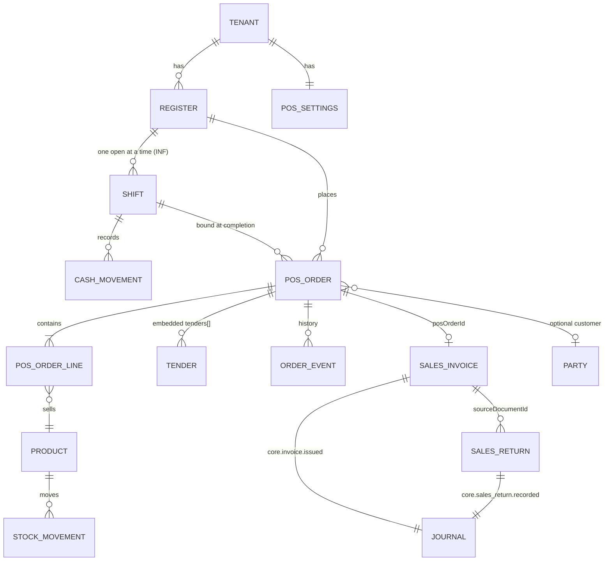

# 04 — POS Domain Model: MeroIMS (observed) → Durby (proposed Prisma)

> **Part A describes MeroIMS as observed through its API. It is not MeroIMS's database schema**, which is not accessible. **Part B is a design recommendation for Durby**, not a reconstruction of MeroIMS.

## Part A — MeroIMS POS entities (as exposed by the API)



| Entity | Observed fields (API) | Key / ownership | Tag |
|---|---|---|---|
| Register | id, tenantId, name, branchId?, branchName, isActive, storeWarehouseId, openShiftId | UUID; tenant (+optional branch) | OBS/TEST |
| PosSettings | storeName/Address/Phone/Pan, currency, vatPercent, deliveryCharge, loyaltyRedeemRate, channel flags (retail/restaurant/mobile/ecommerce), restaurantKitchen/Bar/IgnoreStock, barCategoryIds, tillBgLogoUrl | one per tenant (INF) | OBS |
| Shift | id, tenantId, registerId, openedById, status(open/closed), openingFloat, openedAt, closedAt, closedById, countedCash, closeSummary(JSON snapshot) | UUID; register | TEST |
| CashMovement | id, tenantId, shiftId, registerId, movementType(paid_in/paid_out/drop), amount, reason, createdById, createdAt | UUID; shift | TEST |
| PosOrder | id, tenantId, clientOrderId, orderNumber, channel, status, paymentStatus, partyId?, customerName, placedByUserId/Name, currency, subTotal, discountTotal, taxTotal, deliveryCharge, grandTotal, discountCode?, shiftId?, registerId, branchId?, receiptNumber?, cashReceived?, changeDue, notes?, tableOrderId?, diningTableName?, reservationId?, reservationStatus, driverId?…, placedAt, completedAt | UUID; tenant; `clientOrderId` likely unique per tenant (INF) | TEST |
| PosOrderLine | id, orderId, tenantId, lineNo, productId, name, sku (snapshots), quantity(4 dp), unitPrice, discountAmount, taxAmount, lineTotal(net) | UUID; order | TEST |
| Tender | type(cash/card/gateway/credit), amount (applied), capturedAt (embedded in order) | — | TEST |
| OrderEvent | id, orderId, tenantId, event, fromStatus, toStatus, actorType, actorId, note, createdAt | append-only | TEST |
| Receipt | derived object (store, register, operator, lines, totals, tenders, cash/change), number `RCPT-NNNNNN` | number on order | TEST |
| Sales invoice / return | documentNumber, documentType, status(settled…), posOrderId, sourceDocumentId, lines[kind, unitCost snapshot…], payments[] | documents module | TEST |
| Journal / lines | journalNumber, status(posted), systemGenerated, sourceEventType, sourceDocumentNumber, lines[accountId, debit, credit, productId?, quantity?], audits | accounting module | TEST |
| PostingMapping | eventKey ("global"), role (20 roles), accountId | tenant | TEST |

## Part B — Proposed Durby POS schema (Prisma, PostgreSQL) — RECOMMENDATION

> Status: illustrative design, linted for field types and syntax but **not yet run through `prisma validate`** (needs `datasource`/`generator` blocks and back-relations for the scalar-only foreign keys). Validate in the Durby repo before use.

Design principles (rationale in `07-durby-pos-blueprint.md`):
1. `tenantId` on every row + composite indexes; Postgres Row-Level Security as a second guard.
2. Money `Decimal(12,2)`, quantity `Decimal(14,3)`; never floats.
3. **Append-only** financial facts: orders are never edited after payment; corrections = cancellation/refund records; fiscal records immutable.
4. Idempotency: `clientId` (device-generated UUID) unique per tenant on every write-originating aggregate.
5. Restaurant first-class: tables, seats, courses, modifiers, kitchen tickets.
6. Fiscal (KassenSichV/TSE) records modelled explicitly, never derived on the fly.

```prisma
// ---------- tenancy & people ----------
model Tenant {
  id        String   @id @default(uuid()) @db.Uuid
  name      String
  country   String   @default("DE")
  currency  String   @default("EUR")
  createdAt DateTime @default(now())
  locations Location[]
}

model Location {                       // a restaurant / outlet (Betriebsstätte)
  id        String  @id @default(uuid()) @db.Uuid
  tenantId  String  @db.Uuid
  tenant    Tenant  @relation(fields: [tenantId], references: [id])
  name      String
  address   String
  taxNumber String?                    // Steuernummer / USt-IdNr of the operator
  timezone  String  @default("Europe/Berlin")
  registers Register[]
  areas     FloorArea[]
  @@index([tenantId])
}

model User {                           // back-office login (email + password + MFA)
  id        String  @id @default(uuid()) @db.Uuid
  tenantId  String  @db.Uuid
  email     String
  name      String
  roleId    String  @db.Uuid
  isActive  Boolean @default(true)
  @@unique([tenantId, email])
}

model StaffMember {                    // till operator: waiter / cashier (PIN or NFC)
  id         String  @id @default(uuid()) @db.Uuid
  tenantId   String  @db.Uuid
  displayName String
  pinHash    String
  roleId     String  @db.Uuid
  isActive   Boolean @default(true)
  @@index([tenantId])
}

model Role {
  id          String @id @default(uuid()) @db.Uuid
  tenantId    String @db.Uuid
  name        String
  permissions String[]                 // e.g. "order.void", "refund.create", "shift.close", "price.override"
  @@unique([tenantId, name])
}

// ---------- devices, registers, shifts ----------
model Register {                       // logical till (Kasse); one TSE client per register
  id         String  @id @default(uuid()) @db.Uuid
  tenantId   String  @db.Uuid
  locationId String  @db.Uuid
  location   Location @relation(fields: [locationId], references: [id])
  name       String
  tseClientId String?                  // fiscal client id at the TSE provider
  isActive   Boolean @default(true)
  shifts     Shift[]
  @@unique([tenantId, locationId, name])
}

model Shift {
  id            String    @id @default(uuid()) @db.Uuid
  tenantId      String    @db.Uuid
  registerId    String    @db.Uuid
  register      Register  @relation(fields: [registerId], references: [id])
  status        ShiftStatus @default(OPEN)
  openingFloat  Decimal   @db.Decimal(12, 2)
  openedById    String    @db.Uuid
  openedAt      DateTime  @default(now())
  closedById    String?   @db.Uuid
  closedAt      DateTime?
  countedCash   Decimal?  @db.Decimal(12, 2)
  closeSummary  Json?                  // frozen Z-report snapshot
  zNumber       Int?                   // sequential daily-closing number per register
  cashMovements CashMovement[]
  @@index([tenantId, registerId, status])
}
enum ShiftStatus { OPEN CLOSED }

model CashMovement {                   // Einlage / Entnahme / Geldtransit — journaled
  id        String   @id @default(uuid()) @db.Uuid
  tenantId  String   @db.Uuid
  shiftId   String   @db.Uuid
  shift     Shift    @relation(fields: [shiftId], references: [id])
  type      CashMovementType
  amount    Decimal  @db.Decimal(12, 2)
  reason    String
  createdById String @db.Uuid
  createdAt DateTime @default(now())
  clientId  String   @db.Uuid
  @@unique([tenantId, clientId])
}
enum CashMovementType { PAID_IN PAID_OUT DROP TIP_PAYOUT }

// ---------- floor ----------
model FloorArea {
  id String @id @default(uuid()) @db.Uuid
  tenantId String @db.Uuid
  locationId String @db.Uuid
  location Location @relation(fields: [locationId], references: [id])
  name String
  tables DiningTable[]
}
model DiningTable {
  id       String @id @default(uuid()) @db.Uuid
  tenantId String @db.Uuid
  areaId   String @db.Uuid
  area     FloorArea @relation(fields: [areaId], references: [id])
  label    String
  seats    Int
  qrToken  String? @unique               // table QR ordering (optional)
}

// ---------- catalog ----------
model Category {
  id String @id @default(uuid()) @db.Uuid
  tenantId String @db.Uuid
  name String
  parentId String? @db.Uuid
  stationId String? @db.Uuid
  sortOrder Int @default(0)
}
model Product {
  id          String  @id @default(uuid()) @db.Uuid
  tenantId    String  @db.Uuid
  categoryId  String  @db.Uuid
  name        String
  sku         String?
  barcode     String?
  price       Decimal @db.Decimal(12, 2)        // gross (VAT-inclusive) for German B2C
  taxRateDineIn   TaxRateCode                   // e.g. food 7 % vs drinks 19 % (validate)
  taxRateTakeAway TaxRateCode
  stationId   String? @db.Uuid                  // kitchen / bar routing
  trackStock  Boolean @default(false)
  isActive    Boolean @default(true)
  modifierGroups ProductModifierGroup[]
  @@unique([tenantId, sku])
}
enum TaxRateCode { STANDARD REDUCED ZERO }       // mapped to % per date in TaxRate
model TaxRate {
  id String @id @default(uuid()) @db.Uuid
  country String
  code TaxRateCode
  percent Decimal @db.Decimal(5, 2)
  validFrom DateTime
  validTo DateTime?
}
model ModifierGroup {
  id String @id @default(uuid()) @db.Uuid
  tenantId String @db.Uuid
  name String
  minSelect Int @default(0)
  maxSelect Int @default(1)
  modifiers Modifier[]
}
model Modifier {
  id String @id @default(uuid()) @db.Uuid
  tenantId String @db.Uuid
  groupId String @db.Uuid
  group ModifierGroup @relation(fields: [groupId], references: [id])
  name String
  priceDelta Decimal @db.Decimal(12, 2)
}
model ProductModifierGroup {
  productId String @db.Uuid
  groupId String @db.Uuid
  product Product @relation(fields: [productId], references: [id])
  @@id([productId, groupId])
}
model Station {
  id String @id @default(uuid()) @db.Uuid
  tenantId String @db.Uuid
  locationId String @db.Uuid
  name String
  kind StationKind
  printerAddress String?
}
enum StationKind { KITCHEN BAR }

// ---------- orders ----------
model Order {
  id           String   @id @default(uuid()) @db.Uuid
  tenantId     String   @db.Uuid
  clientId     String   @db.Uuid                 // device idempotency key
  locationId   String   @db.Uuid
  registerId   String?  @db.Uuid
  shiftId      String?  @db.Uuid                 // bound when settled
  tableId      String?  @db.Uuid
  channel      OrderChannel
  status       OrderStatus @default(OPEN)
  serviceType  ServiceType @default(DINE_IN)     // drives VAT rate selection
  guestCount   Int?
  openedById   String   @db.Uuid
  orderNumber  String
  subTotal     Decimal  @db.Decimal(12, 2) @default(0)
  taxTotal     Decimal  @db.Decimal(12, 2) @default(0)
  discountTotal Decimal @db.Decimal(12, 2) @default(0)
  tipTotal     Decimal  @db.Decimal(12, 2) @default(0)
  grandTotal   Decimal  @db.Decimal(12, 2) @default(0)
  openedAt     DateTime @default(now())
  closedAt     DateTime?
  version      Int      @default(0)            // optimistic locking for concurrent waiters
  lines        OrderLine[]
  payments     Payment[]
  events       OrderEvent[]
  @@unique([tenantId, clientId])
  @@unique([tenantId, orderNumber])
  @@index([tenantId, status, tableId])
}
enum OrderChannel { POS_COUNTER POS_TABLE QR_TABLE TAKEAWAY DELIVERY }
enum ServiceType  { DINE_IN TAKE_AWAY }
enum OrderStatus  { OPEN SENT PARTIALLY_PAID PAID CANCELLED REFUNDED }

model OrderLine {
  id          String  @id @default(uuid()) @db.Uuid
  tenantId    String  @db.Uuid
  orderId     String  @db.Uuid
  order       Order   @relation(fields: [orderId], references: [id])
  lineNo      Int
  productId   String  @db.Uuid
  nameSnapshot String
  quantity    Decimal @db.Decimal(14, 3)
  unitPrice   Decimal @db.Decimal(12, 2)            // gross
  taxRateCode TaxRateCode
  taxPercent  Decimal @db.Decimal(5, 2)             // snapshot at sale time
  discountAmount Decimal @db.Decimal(12, 2) @default(0)
  lineTotal   Decimal @db.Decimal(12, 2)
  course      Int?
  seat        Int?
  note        String?
  status      LineStatus @default(PENDING)
  voidReason  String?                                // voids are recorded, never deleted
  modifiers   OrderLineModifier[]
  @@unique([orderId, lineNo])
}
enum LineStatus { PENDING SENT_TO_KITCHEN SERVED VOIDED }
model OrderLineModifier {
  id String @id @default(uuid()) @db.Uuid
  lineId String @db.Uuid
  line OrderLine @relation(fields: [lineId], references: [id])
  modifierId String @db.Uuid
  nameSnapshot String
  priceDelta Decimal @db.Decimal(12, 2)
}

model KitchenTicket {
  id         String   @id @default(uuid()) @db.Uuid
  tenantId   String   @db.Uuid
  orderId    String   @db.Uuid
  stationId  String   @db.Uuid
  ticketNo   Int
  status     TicketStatus @default(NEW)
  firedAt    DateTime @default(now())
  items      Json                                   // line ids + qty + modifiers snapshot
}
enum TicketStatus { NEW IN_PROGRESS READY SERVED CANCELLED }

model OrderEvent {                                  // append-only audit of every state change
  id        String   @id @default(uuid()) @db.Uuid
  tenantId  String   @db.Uuid
  orderId   String   @db.Uuid
  order     Order    @relation(fields: [orderId], references: [id])
  type      String                                   // created, line_added, sent, voided, split, paid, refunded…
  actorId   String   @db.Uuid
  payload   Json
  createdAt DateTime @default(now())
}

// ---------- payments, receipts, refunds ----------
model Payment {
  id          String   @id @default(uuid()) @db.Uuid
  tenantId    String   @db.Uuid
  clientId    String   @db.Uuid
  orderId     String   @db.Uuid
  order       Order    @relation(fields: [orderId], references: [id])
  shiftId     String   @db.Uuid
  method      PaymentMethod
  amount      Decimal  @db.Decimal(12, 2)           // negative for refunds
  tipAmount   Decimal  @db.Decimal(12, 2) @default(0)
  tendered    Decimal? @db.Decimal(12, 2)
  change      Decimal? @db.Decimal(12, 2)
  terminalRef String?                                // card terminal / PSP transaction id
  status      PaymentStatus
  createdAt   DateTime @default(now())
  @@unique([tenantId, clientId])
}
enum PaymentMethod { CASH CARD VOUCHER ONLINE }
enum PaymentStatus { PENDING CAPTURED FAILED REFUNDED }

model Receipt {
  id            String   @id @default(uuid()) @db.Uuid
  tenantId      String   @db.Uuid
  orderId       String   @db.Uuid
  registerId    String   @db.Uuid
  receiptNumber String
  kind          ReceiptKind                           // SALE, REFUND, CANCELLATION, TRAINING
  issuedAt      DateTime @default(now())
  fiscalTxId    String?  @db.Uuid
  payload       Json                                  // frozen printable content
  @@unique([tenantId, registerId, receiptNumber])
}
enum ReceiptKind { SALE REFUND CANCELLATION TRAINING }

model Refund {
  id        String   @id @default(uuid()) @db.Uuid
  tenantId  String   @db.Uuid
  orderId   String   @db.Uuid
  reason    String
  restock   Boolean
  createdById String @db.Uuid
  createdAt DateTime @default(now())
  lines     Json                                     // [{orderLineId, quantity, amount}]
}

// ---------- fiscal (Germany) ----------
model FiscalTransaction {                            // one per TSE transaction (immutable)
  id            String   @id @default(uuid()) @db.Uuid
  tenantId      String   @db.Uuid
  registerId    String   @db.Uuid
  orderId       String?  @db.Uuid
  processType   String                               // e.g. Kassenbeleg-V1, Bestellung-V1, SonstigerVorgang
  processData   String
  tseSerial     String
  txNumber      BigInt
  signatureCounter BigInt
  startTime     DateTime
  endTime       DateTime
  signature     String
  qrPayload     String?
  status        FiscalStatus
  createdAt     DateTime @default(now())
  @@unique([tenantId, tseSerial, txNumber])
}
enum FiscalStatus { STARTED FINISHED FAILED }

// ---------- inventory & accounting (minimal, POS-driven) ----------
model StockMovement {
  id String @id @default(uuid()) @db.Uuid
  tenantId String @db.Uuid
  productId String @db.Uuid
  locationId String @db.Uuid
  quantity Decimal @db.Decimal(14, 3)
  sourceType String
  sourceId String @db.Uuid
  createdAt DateTime @default(now())
}
model Recipe {
  id String @id @default(uuid()) @db.Uuid
  tenantId String @db.Uuid
  productId String @db.Uuid
  ingredientId String @db.Uuid
  quantity Decimal @db.Decimal(14, 3)
}
model JournalEntry {
  id String @id @default(uuid()) @db.Uuid
  tenantId String @db.Uuid
  sourceType String
  sourceId String @db.Uuid
  postedAt DateTime @default(now())
  reversalOfId String? @db.Uuid
  lines Json
}

// ---------- infrastructure ----------
model OutboxEvent {
  id String @id @default(uuid()) @db.Uuid
  tenantId String @db.Uuid
  type String
  payload Json
  createdAt DateTime @default(now())
  publishedAt DateTime?
  @@index([publishedAt])
}
model AuditEvent {
  id String @id @default(uuid()) @db.Uuid
  tenantId String @db.Uuid
  actorId String @db.Uuid
  action String
  entityType String
  entityId String @db.Uuid
  before Json?
  after Json?
  createdAt DateTime @default(now())
  @@index([tenantId, entityType, entityId])
}
// gap-free numbering via SELECT … FOR UPDATE
model NumberSeries {
  tenantId String @db.Uuid
  scope String
  nextValue BigInt
  @@id([tenantId, scope])
}
```

### Mapping: MeroIMS observation → Durby decision
| MeroIMS (observed) | Durby (recommended) | Why |
|---|---|---|
| Tenders embedded in order; refunds add no tender | `Payment` rows, **negative payments for refunds** bound to the refunding shift | drawer and Z-report must include refunds (S4/S7 gap) |
| Card → Cash In Hand | Card → card-clearing account, settled against PSP payouts | GL accuracy |
| Cash movements not journaled | `CashMovement` posts journals (Einlage/Entnahme/Geldtransit) | GoBD/cash-book completeness |
| Variance not journaled | Z-close posts over/short | books match drawer |
| VAT-exclusive prices (Nepal) | **Gross (VAT-inclusive) prices** with per-line tax snapshot; dine-in vs take-away rate | German B2C practice |
| Selective audit log | `AuditEvent` for every config + financial action | compliance |
| No fiscal fields on receipt | `FiscalTransaction` + receipt QR/signature | KassenSichV |
| `clientOrderId` | `clientId` on Order, Payment, CashMovement | offline/idempotent sync |
| Order `status` incl. delivery states | separate `OrderStatus` (financial) and `KitchenTicket.status` (production) | restaurants need both |
