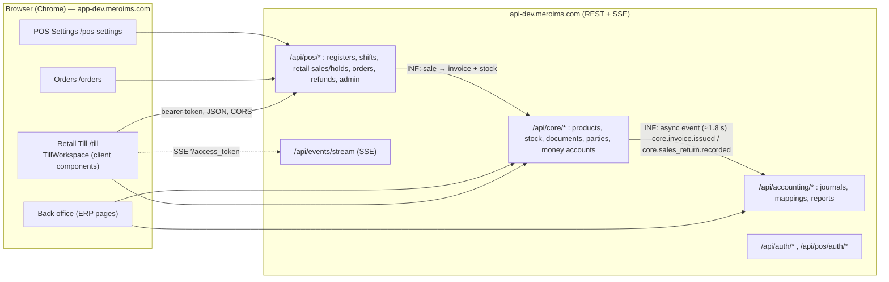
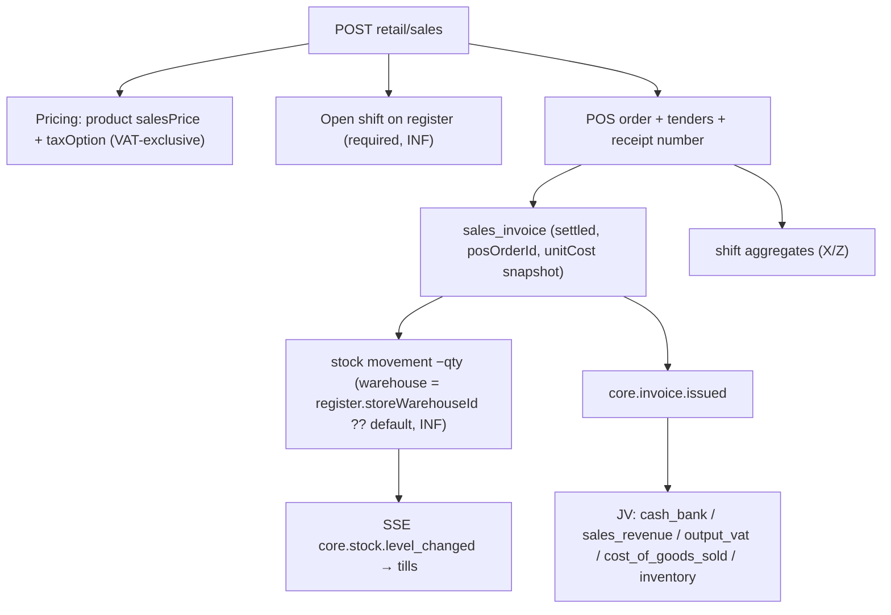

# 05 — MeroIMS POS Architecture (observed) & Service Dependencies

Only what the browser could see is stated as fact. Server internals are **inferred** from API behaviour, or **unknown**.

## 1. System context

| Layer | Finding | Tag |
|---|---|---|
| Frontend | Next.js App Router (RSC shell, `?_rsc` prefetch), React client components, Turbopack bundle; till code lazy-loaded per route | OBS |
| Origins | frontend `app-dev.meroims.com`, API `api-dev.meroims.com` (separate deployment, CORS) | OBS |
| Auth | bearer access token + rotating refresh token (`POST /api/auth/refresh`); token kept client-side (`localStorage: ims.session`, INF); SSE token in query string | OBS / INF |
| Tenancy | `tenantId` on every record; active tenant carried in the token (refresh response includes `tenantId`) | OBS / INF |
| API style | REST, JSON, decimal strings, list envelope `{data, meta}`, error `{code, message}` (403 on feature gate) | OBS |
| Module split | `pos`, `core`, `accounting`, `auth` namespaces; framework (NestJS?) **UNK**: no server banner/header evidence collected | OBS / UNK |
| Posting | journals created asynchronously from domain events (`sourceEventType`, `sourceEventId`), rules from `mappings` (role × eventKey) | OBS / INF |
| Realtime | SSE stream; till listens to `core.stock.level_changed` to update stock tiles | OBS / BND |
| Feature gating | tenant flags in settings + server-side 403 for disabled channels | OBS |
| Numbering | `ORD-YYYY-NNNNNN` (orders), `RCPT-NNNNNN` (receipts), `INV-YYYY-NNNNNN`, `SRT-YYYY-NNNNNN`, `JV-YYYY-NNNNNN` | TEST |
| Database / queue / hosting | **UNK** (no evidence) | UNK |

## 2. Frontend till structure (from client code, BND)
- `retailApi` client object: `context, products, lookup, sale, hold, holds, finalizeHold, openShift, closeShift, xReport, cashMovement, receipt, searchParties`.
- `useTillSession`: loads context, picks register (`localStorage["ims.till.register"]` ?? first), joins open shift, opens SSE, loads products, builds barcode/SKU lookup map client-side.
- `TillWorkspace({eyebrow, session, cart, holds, view, ignoreStock, notice, emptyTicket})`: shared till layout (retail; restaurant inferred).
- Tender dialog: modes cash/card/qr(gateway)/credit/split, each toggleable via a per-page UI profile (`useTillUi().show("tab.card")` etc.).
- Thermal printing: `openThermalPrint(buildZReportHtml(...))` → HTML for 80 mm printers (browser print, no device driver) (BND).
- Keyboard-first: F8 hold, F9 resume, F10 tender, Enter complete.

## 3. Runtime dependencies of a POS sale

## 4. Dependency matrix (POS ↔ supporting modules)
| POS capability | Products | Stock | Documents | Accounting | Parties | Settings | SSE |
|---|---|---|---|---|---|---|---|
| Open/close shift | | | | ✗ (no journal) | | ✓ registers | |
| Sale / finalize | ✓ price, tax | ✓ −qty | ✓ invoice | ✓ journal | optional | ✓ VAT, channels | ✓ stock |
| Hold | ✓ | ✗ (UNK reservation) | | | optional | | |
| Refund | ✓ | ✓ +qty if restock | ✓ sales return | ✓ journal | | | ✓ (INF) |
| Cash movement | | | | ✗ | | | |
| Receipt | | | | | | ✓ store details | |

## 5. Unknowns that matter for architecture
Server framework and DB · transaction boundary between order, invoice and stock · whether posting uses an outbox/queue · retry/idempotency behaviour on duplicate `clientOrderId` · concurrency control (two tills, same hold) · stock reservation on hold · POS-staff auth model · printer/drawer integration beyond browser printing · backup/HA setup.
