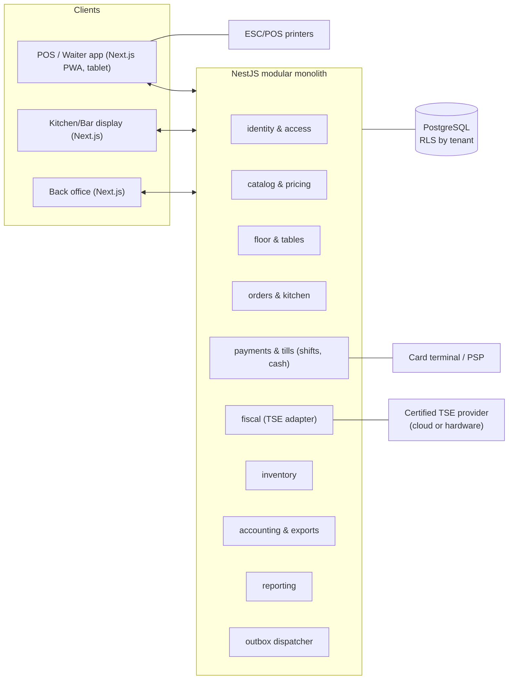
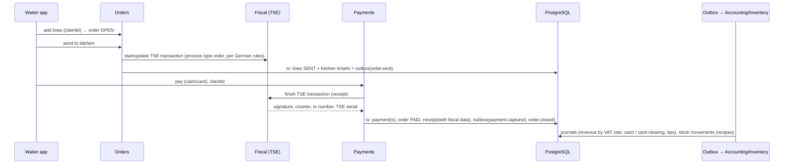

# 07 — Durby POS Technical Blueprint (Recommendation)

**Stack:** Next.js + React + TypeScript (frontend) · NestJS (API) · Prisma · PostgreSQL.
**Scope:** restaurant POS with billing, payments, staff, light inventory and the accounting it must produce; designed to grow into ERP later.
**Honesty rule:** sections marked **[MeroIMS OBS]** cite tested MeroIMS behaviour; everything else is a **design recommendation for Durby**, not a claim about MeroIMS. German fiscal compliance is a separate, gating workstream (`08-german-compliance-workstream.md`).

---

## 1. What we learned from MeroIMS (input to the design)
| Learning | Evidence | Durby decision |
|---|---|---|
| Server-side pricing, client sends product + qty | S3 [MeroIMS OBS] | **Keep.** Clients never send prices except explicit, permission-checked overrides |
| Client idempotency key per sale (`clientOrderId`) | S3 [MeroIMS OBS] | **Keep and extend** to every client-originated write (payments, cash movements, kitchen fires) |
| Order event history (append-only) | S4 [MeroIMS OBS] | **Keep**: `OrderEvent` for every state change |
| Frozen Z-report snapshot on close, blind count | S7 [MeroIMS OBS] | **Keep**, plus sequential Z-number per register |
| Event-driven journal posting with source back-reference | S3–S5 [MeroIMS OBS] | **Keep**, using a transactional outbox |
| Refunds not deducted from expected cash | S4/S7 [MeroIMS OBS] | **Fix**: refunds are negative payments in the refunding shift |
| Card booked to Cash In Hand | S5 [MeroIMS OBS] | **Fix**: card → card-clearing account |
| Cash movements & variance not journaled | S6/S7 [MeroIMS OBS] | **Fix**: journal Einlage / Entnahme / Geldtransit and over/short |
| Config changes not audited | S1 [MeroIMS OBS] | **Fix**: audit every config + financial action |
| No fiscal fields on receipts | S3 [MeroIMS OBS] | **Required**: TSE signing (Germany) |
| Held orders visible tenant-wide, not shift-bound | S5 [MeroIMS OBS] | Restaurant "open tabs" bound to location; shift assigned at payment, as in MeroIMS |
| Restaurant mode exists but was not observable | b6 probe | Design restaurant flows from requirements, not from MeroIMS |

## 2. Architecture: a modular monolith
**Recommendation:** one NestJS application, one PostgreSQL database, strict module boundaries. Microservices would add distributed transactions, deployment overhead and consistency problems a single restaurant group doesn't need. Module boundaries keep later extraction possible (e.g. fiscal or kitchen service).

| Module | Owns | Publishes events |
|---|---|---|
| identity & access | tenants, locations, users, staff (PIN), roles/permissions, devices | `staff.logged_in`, … |
| catalog & pricing | categories, products, modifiers, tax rates (dated), price rules | `catalog.changed` |
| floor & tables | areas, tables, table sessions, transfers/merges | `table.opened`, `table.transferred` |
| orders & kitchen | orders, lines, modifiers, courses, kitchen tickets, voids | `order.sent`, `order.line_voided`, `order.closed` |
| payments & tills | registers, shifts, payments (incl. negative), cash movements, receipts, X/Z | `payment.captured`, `refund.issued`, `shift.closed` |
| fiscal | TSE transactions, signatures, DSFinV-K export, fiscal outage handling | `fiscal.signed`, `fiscal.failed` |
| inventory | stock movements, recipes (ingredient consumption), counts | `stock.changed` |
| accounting & exports | journals (via posting rules), DATEV export | — |
| reporting | read models / materialized views | — |

**Rules:** modules talk via application services (in-process) for commands and via the outbox for side effects. Each module has its own Prisma models and tables (shared schema, prefixed or schema-per-module), and no module writes another's tables.

## 3. Multi-tenancy & isolation
- `tenantId` on every row; tenant resolved from the authenticated principal (never from client input); a NestJS request-scoped context.
- **PostgreSQL Row-Level Security** as defence in depth: `SET app.tenant_id` per transaction via a Prisma client extension; policies `USING (tenant_id = current_setting('app.tenant_id')::uuid)`.
- Location (restaurant) scoping for staff and devices; roles bound per location.
- Test: automated cross-tenant access tests in CI.

## 4. API & DTO design
- REST under `/api/v1/...`, JSON, OpenAPI generated from NestJS decorators; DTOs validated with `class-validator`/Zod; shared TypeScript types via a generated client for the Next.js apps.
- Money as decimal strings in JSON (as MeroIMS does), `Decimal` in Prisma; never JS floats in business logic (use `decimal.js`).
- Every command endpoint accepts `clientId` (UUID); server stores it with a unique constraint and returns the original result on replay (idempotent).
- Optimistic concurrency (`version`) on orders/tables: waiters editing the same table get a 409 with the latest state.
- Error envelope `{ code, message, details? }` with stable machine codes.
- Real-time: SSE or WebSockets per location channel (orders, kitchen tickets, table status, stock). Auth via short-lived ticket, **not the access token in the query string** (MeroIMS does that; tokens end up in logs).

## 5. Order → payment → fiscal → posting (core transaction design)

- **Transaction boundary:** order state + payment + receipt + outbox row in **one DB transaction**; accounting and inventory follow asynchronously from the outbox (MeroIMS takes about 1.8 s for this step). Journals are idempotent on `(sourceType, sourceId)`.
- **Fiscal failure:** if the TSE is unreachable, record the payment with a fiscal-failure flag, print a receipt noting the failure, and retry or flag per the compliance rules. Never block service silently.
- **Numbering:** gap-free sequences per register (`NumberSeries` with row lock). Separate order number, receipt number, Z-number.

## 6. Accounting correctness
- Posting rules table (role × event), like MeroIMS's mappings, but **no shortcuts**: cash → cash account, card → card-clearing, tips → tips liability, vouchers → voucher liability, VAT per rate (7 % / 19 % to be confirmed), revenue per category.
- Refund = negative payment + reversing journal (never edit originals). Void before payment = `OrderEvent`/line status (fiscally recorded), no journal.
- Shift close posts over/short; cash movements post journals; card-clearing reconciles against PSP settlement reports.
- Immutable financial history: no UPDATE/DELETE on payments, receipts, fiscal transactions or journals (DB-level revoke + triggers).

## 7. Inventory (light, restaurant-oriented)
- `trackStock` products (bottled drinks) decrement directly; dishes consume ingredients via `Recipe` on `order.closed` (or on `order.sent`, configurable).
- Stock movements are append-only with `(sourceType, sourceId)`; levels are a materialized aggregate. Allow negative stock by default (restaurants can't stop service), with alerts.
- Concurrency: decrements are inserts, not read-modify-write, so there are no lost updates. Level recomputation uses `SELECT … FOR UPDATE` per product-location or periodic aggregation.

## 8. Offline-capable POS
- Recommended level: **"degraded online"** first. A PWA caches catalog and floor, queues commands with `clientId` in IndexedDB, and replays them in order. Payments by card need a live terminal anyway.
- Hard limits offline: TSE signing needs the TSE (cloud TSE needs internet; a local hardware TSE does not), so the offline strategy depends on the TSE choice. Decide this in the compliance workstream.
- Conflict policy: server is authoritative; replays are idempotent; table conflicts resolved by `version`.

## 9. Payments
- Cash: tendered/change on the payment row; drawer kick via printer.
- Card: integrate a terminal (common German options: ZVT protocol terminals, or a PSP terminal SDK). Keep card data out of Durby (PCI scope minimisation): store only the terminal reference, masked PAN and auth code.
- Split bill (by seat/item/amount), multiple tenders, tips (card tip on terminal or cash tip), vouchers later.

## 10. Printing & devices
ESC/POS network printers for receipts and kitchen/bar tickets (station routing by category, as MeroIMS's `barCategoryIds` hints). Print from the server via a print-queue worker, or from the client via a local bridge; decide per hardware. Cash drawer kick via the receipt printer.

## 11. Security
Back-office login with password + MFA; staff PIN on registered devices only; device registration with revocable tokens; refresh-token rotation (MeroIMS does this) with httpOnly cookies for the web back office instead of localStorage (MeroIMS stores session client-side, INF). Permission checks on void, refund, discount, price override, drawer open, shift close, all audited. Rate limiting, CSP, dependency scanning.

## 12. Testing, deployment, operations
- Tests: unit (pricing, tax, rounding, posting rules) · integration (Prisma + Postgres via Testcontainers) · contract tests (OpenAPI) · E2E (Playwright: open table → order → kitchen → split pay → close shift) · fiscal sandbox tests against the TSE provider's test environment · cross-tenant isolation tests.
- Deploy: containerised API + Next.js; managed PostgreSQL with PITR backups; staging = production-like with TSE test environment; migrations via `prisma migrate deploy` in CI; zero-downtime (expand/contract migrations).
- Observability: structured logs (no tokens in URLs), OpenTelemetry traces, metrics (orders/min, fiscal failures, outbox lag), alerting on fiscal errors and outbox backlog.
- Backups: daily + PITR; restore drills; fiscal/receipt data retained per legal retention (see 08).

## 13. What remains uncertain
Restaurant workflows of MeroIMS (not observable) · TSE provider choice (drives offline design) · card terminal vendor · exact German VAT treatment for the menu · whether Durby needs delivery/QR ordering in v1.
