# 09 — Durby POS Phased Roadmap

Principles: ship a usable counter/table POS early, but **no German production use before the compliance workstream (08) is accepted**. Each phase ends with demonstrable, tested functionality. Priorities: **P0** = required for first restaurant go-live, **P1** = shortly after, **P2** = later / ERP path.

```mermaid
gantt
  dateFormat  X
  axisFormat  %s
  section Foundations
  P0 Phase 0 Foundations           :p0, 0, 3
  section Core
  P0 Phase 1 Catalog & config      :p1, after p0, 2
  P0 Phase 2 Counter POS core      :p2, after p1, 3
  P0 Phase 3 Table service & kitchen :p3, after p2, 4
  P0 Phase 4 Card payments & tips  :p4, after p2, 2
  section Compliance (parallel, gating)
  P0 Fiscal workstream (08)        :c1, after p0, 9
  section After go-live
  P1 Phase 5 Inventory & accounting exports :p5, after p3, 3
  P2 Phase 6 Offline, multi-site, QR & delivery :p6, after p5, 4
```

(Durations are relative sizing units, not calendar weeks.)

## Phase 0: Foundations (P0)
**Scope:** monorepo (Next.js apps + NestJS API + shared types), PostgreSQL + Prisma migrations, CI (lint, test, migrate), environments (dev/staging/prod), tenancy context + RLS, auth (back-office users + MFA), staff PIN + device registration, roles/permissions, `AuditEvent`, `OutboxEvent` dispatcher, `NumberSeries`, error envelope, OpenAPI client generation, observability baseline.
**Depends on:** nothing.
**Acceptance:** cross-tenant access test fails closed; audit entry for every write in a sample module; outbox delivers exactly-once-effect (idempotent consumer) under retry; staging deploy from CI with migrations.

## Phase 1: Catalog & configuration (P0)
**Scope:** locations, registers, stations (kitchen/bar + printers), floor areas & tables, categories, products (gross prices, dine-in/take-away tax codes), modifier groups, dated tax-rate table, receipt/business details, back-office UI.
**Depends on:** Phase 0.
**Acceptance:** a manager configures a restaurant end-to-end in the back office; every config change audited; tax rate effective-dating covered by tests.

## Phase 2: Counter POS core (P0)
**Scope:** till PWA (keyboard + touch), shift open (float) / X-report / close (blind count, Z-snapshot, Z-number), cart with modifiers, cash payment with change, receipts (print + digital), **refund as negative payment**, line void before payment, cash movements (journaled), idempotent commands (`clientId`), SSE updates.
**Depends on:** Phase 1; fiscal adapter skeleton from the compliance workstream.
**Acceptance (regression suite mirrors MeroIMS tests S2–S7, with the gaps fixed):**
- Sale 1 item cash: totals, VAT per rate, receipt numbering correct; replaying the same `clientId` returns the same order (no duplicate).
- Refund in the same shift **reduces expected cash**; Z variance = 0 when counted correctly.
- Paid-in/out/drop post journals; Z over/short posts a journal.
- Card never posts to cash (card arrives in Phase 4, but the posting rule is tested now with a stub).

## Phase 3: Table service & kitchen (P0)
**Scope:** floor view, open/transfer/merge tables, waiter app, courses & firing, kitchen/bar tickets (printer + KDS), ticket status, split bill (by item/seat/amount), guest count, order-before-payment fiscal recording, permissions for voids/discounts.
**Depends on:** Phase 2; fiscal module able to record orders before payment.
**Acceptance:** E2E: two waiters on two tablets edit the same table → optimistic-lock conflict handled; fired items reach the right station; split bill produces correct receipts and fiscal transactions; every void is visible in reports and fiscal data.

## Phase 4: Card payments & tips (P0)
**Scope:** terminal integration (chosen vendor), card tender, mixed tender, tips (card + cash), card-clearing account, settlement reconciliation report.
**Depends on:** Phase 2; vendor selection.
**Acceptance:** card payment success/decline/timeout handled without double charge (idempotent + terminal reference); tips reported separately; clearing account reconciles with a settlement file.

## Compliance workstream (parallel, gating): see `08`
**Acceptance:** all items in 08 §4 met in staging with the TSE test environment; Steuerberater sign-off. **Go-live gate.**

## Phase 5: Inventory & accounting exports (P1)
**Scope:** recipes (ingredient consumption on close), direct-stock items (bottles), stock counts, low-stock alerts, cost of goods, journals per posting rules, **DATEV export**, sales/VAT/staff reports.
**Depends on:** Phases 2–4.
**Acceptance:** stock movements reconcile with sold quantities × recipes; DATEV export imports cleanly at the tax advisor; VAT report equals fiscal and payment totals.

## Phase 6: Offline resilience, multi-site, QR & delivery (P2)
**Scope:** queued offline commands (bounded by TSE choice), multi-location group reporting, QR table ordering, delivery platform integrations, loyalty/vouchers, path towards purchasing & full accounting (ERP backlog).
**Depends on:** Phase 5; TSE type decision.
**Acceptance:** network-loss drills: no lost or duplicated orders/payments; per-location isolation verified.

## Cross-cutting definition of done
OpenAPI updated · migrations reversible (expand/contract) · unit + integration + E2E tests green · audit + outbox coverage for new writes · permissions enforced and tested · no money as float · documentation (incl. Verfahrensdokumentation impact) updated.

## Open decisions to take before Phase 2
1. TSE provider + type (cloud vs hardware) → offline scope.
2. Card terminal vendor.
3. Printer strategy (server print-queue vs local bridge).
4. Whether to investigate MeroIMS restaurant mode further (requires enabling it in the dev tenant: a separate, approved test).
