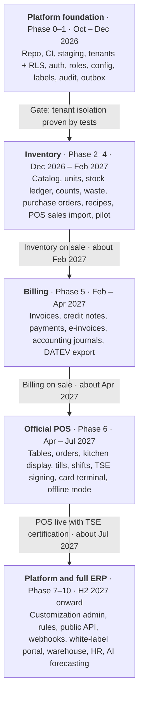

# Durby — What We're Building

Oct 26, 2026 · Yuvanesh Raju

## TL;DR

Durby is building one restaurant platform that can be sold as a single module, as a full suite, or under a partner's own brand. We sell **Inventory first, then Billing, then an official German POS**, and grow into a full restaurant ERP with AI on top. The goal for the first 12 months is **70–100 restaurant locations**, Berlin first, then the rest of Germany.

Durby (durby.tech) is the product. ExtraHand is the parent company. One customer with 4 Berlin branches already uses Durby's restaurant and warehouse inventory every day.

## The problem

Restaurants run on a patchwork of tools that don't talk to each other: one POS, a spreadsheet for stock, paper delivery notes, a separate invoicing tool and an accountant who gets everything late. Owners can't see food cost, waste or stock in real time, and multi-branch groups have it worst.

Existing software forces a choice. Big ERPs are too heavy and expensive for restaurants. Restaurant POS vendors lock customers into their whole package. Very few tools let a restaurant buy only the part it needs, rename things to match how it works, or let a partner resell it under their own brand.

## What Durby is

Durby is **one codebase that behaves like many products**. Every customer runs on the same standard software, and differences between customers are configuration, never custom code.

- **Modular:** each module (Inventory, Billing, POS, …) works on its own. Inventory, for example, works with a restaurant's existing third-party POS.
- **White-label:** a partner can sell Durby under their own name, logo, colours and domain.
- **Configurable per client:** features, settings, wording (Client A sees "Inventory", Client B sees "Products"), custom fields, screens and rules can all change per client without a deploy.
- **AI-native:** forecasting, menu intelligence, loyalty and automatic re-ordering sit on top of clean operational data. This is Durby's edge over classic restaurant software.

The rule behind all of it: if a client wants something, first ask whether it can be a **label, a flag, a field or a rule**. If it has to be code, it becomes a general feature that the next client can buy too.

## Who we serve and how we sell

We start with independent restaurants and small multi-branch groups in Berlin, then expand across Germany. Later, resellers and POS partners can sell Durby under their own brand.

| Way to buy | Who it's for | What they get |
| --- | --- | --- |
| Single module | A restaurant happy with its current POS | Only Inventory, or only Billing |
| Full suite | A restaurant replacing its tools | Inventory + Billing + POS, all connected |
| Standard product | Most customers | Durby as-is, set up through configuration |
| Customized | Customers with special needs | Same product plus their own labels, fields, screens and rules |
| White-label | Partners and resellers | Durby under the partner's brand and domain |

Current pricing is per location per month: Starter €49, Growth €99, Pro €179, Enterprise custom.

## Roadmap

We sell Inventory first because it needs no fiscal certification, then add Billing and the official POS to the same customers.

Each stage reuses what came before: Billing builds on the Inventory catalog, and the POS builds on both. Dates are targets for a solo founder building with Claude Code, and the POS date depends on the TSE provider.

## Goals

In the first 12 months we win **70 restaurant locations (100 in the upside case)** by selling Inventory first and adding modules to the same customers.

1. **Business:** 70–100 paying locations, Berlin first, then Germany. Most of the growth comes from customers adding modules.
2. **Product:** Inventory sellable around Feb 2027, Billing around Apr 2027, official POS around Jul 2027.
3. **Platform:** one codebase serves every customer. No forks and no tenant-specific code, so a new client is set up through configuration.
4. **Quality:** tenant data fully isolated, financial and stock history never edited, German fiscal rules met before the POS goes live.
5. **Customization:** most client requests are handled through labels, flags, fields and rules, without writing new code.

Open questions:

- [ ] Final company or product name: Durby, or a new name such as tavo.restaurant?
- [ ] How do we move the existing customer from today's live inventory to the new platform?

## How we build

Durby is one NestJS application with strict internal modules (a modular monolith) on one PostgreSQL database. This is simple to run today and can be split into separate services later. The full detail is in `docs/architecture/ARCHITECTURE.md` and the rules in `CLAUDE.md`.

| Layer | What it does |
| --- | --- |
| 1. Edge | Finds the partner, organization, brand and location from the domain; applies branding |
| 2. Config & entitlements | Plans, feature switches, settings, labels, custom fields, UI profiles, rules, number series |
| 3. Frontend | Next.js admin, later an offline-capable POS app and a kitchen display |
| 4. Backend | NestJS modules (Catalog, Inventory, Purchasing, Billing, Accounting, POS, Fiscal, …) on a shared platform (auth, roles, audit, events) |
| 5. Data | PostgreSQL + Prisma, every row tagged with its tenant and protected by row-level security |

Customers are organised as **Partner → Organization → Brand → Location**. Settings flow down that tree, and the most specific level wins.

The non-negotiable rules:

- One customer can never see another customer's data.
- No code written for one specific client.
- No hardcoded text in the UI. Every word can be renamed per client.
- Money and stock use exact decimals, and their history is never edited, only corrected with new entries.
- Every change is audited, and every endpoint checks both the plan and the user's permissions.

We build with Claude Code, one small step at a time: plan, review, test, commit. Staging runs on our Hetzner server at staging.durby.tech.

## What we learned from MeroIMS

We studied MeroIMS, a comparable ERP (inventory, sales, accounting, POS), in a read-only investigation with a few approved test transactions. The research is in `docs/meroims/`. Our conclusion: it is a standard product with on/off switches, which handles "Client A gets POS, Client B doesn't" but not deeper per-client differences.

|  | MeroIMS | Durby |
| --- | --- | --- |
| Feature switches | One database column per feature | Rows in a table, so new features need no migration |
| Settings | Flat, per tenant | Inherited: partner → organization → brand → location |
| Wording | Hardcoded in the app | Every label renameable per client |
| Custom fields | Internal use only | Client-defined fields on any entity |
| Accounting | Event-driven posting (good) | Same pattern, plus fixes for the bugs we found: card payments booked as cash, refunds missing from the expected cash in the till |
| Audit | Config changes not audited | Every change audited |

What we keep from MeroIMS: prices calculated on the server, idempotency keys on sales, append-only order history, and plan limits enforced by the server.

## Germany compliance

The official POS can't go live in Germany without certified fiscal signing (TSE). That's the main reason we sell Inventory and Billing first: they don't need it.

| Area | Needed for | What it means |
| --- | --- | --- |
| KassenSichV / TSE | POS | Every sale is signed by a certified security module |
| DSFinV-K | POS | Standard export of cash register data for tax audits |
| XRechnung / ZUGFeRD | Billing | Structured e-invoices; B2B e-invoicing is being phased in |
| DATEV export | Billing, POS | Hand-over of bookings to the restaurant's accountant |
| GDPR | Everything | Customer and staff data protection, EU hosting |

Billing is positioned for **B2B invoices** (catering, events, corporate clients) until the POS is ready. If it's used to charge guests at the counter, it likely counts as a cash register that needs a TSE. We'll confirm this with a Steuerberater before launch.

- [ ] Choose a TSE provider and get sandbox access
- [ ] Choose a card-terminal provider
- [ ] Steuerberater review of the Billing positioning

## Getting started as a new team member

Your first week is for reading and running the project, not shipping features.

1. Read this document, then `CLAUDE.md` (the rules) and `docs/architecture/ARCHITECTURE.md` (the design).
2. Skim `docs/meroims/`, especially the POS blueprint and the inventory investigation.
3. Clone the repo, run `docker compose up`, `pnpm install` and `pnpm dev`, and get the tests green locally.
4. Read `docs/plan/` to see which phase we're in and what's next.
5. Pick a small task, plan it in writing first, and open a PR. The PR checklist mirrors the hard rules.

When you're unsure, ask: "Can this be a label, a flag, a field or a rule?" If not, talk to Yuvanesh before writing client-specific code.
